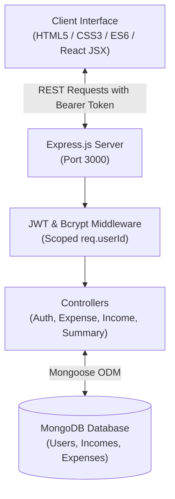

# Finora — Full Stack Personal Expense & Financial Tracker

[](https://nodejs.org/)
[](https://expressjs.com/)
[](https://www.mongodb.com/)
[](https://jwt.io/)
[](https://developer.mozilla.org/en-US/docs/Web/JavaScript)
[](https://react.dev/)

**Finora** is a production-grade, full-stack fintech personal finance web application designed to help individuals track their income, monitor expenses, manage category budgets, achieve savings goals, and visualize spending habits through interactive reports.

Finora offers **strict multi-tenant user isolation**, JWT authentication with secure session management, a modular RESTful backend, and a curated fintech design system.

---

## 📑 Table of Contents

- [Key Features](#-key-features)
- [Design System & Palette](#-design-system--palette)
- [Architecture & Tech Stack](#-architecture--tech-stack)
- [Project Directory Structure](#-project-directory-structure)
- [Screens & User Interface](#-screens--user-interface)
- [REST API Reference](#-rest-api-reference)
- [Data Models](#-data-models)
- [Getting Started & Installation](#-getting-started--installation)
- [Environment Configuration](#-environment-configuration)
- [Testing & Quality Assurance](#-testing--quality-assurance)
- [Security & Data Isolation](#-security--data-isolation)
- [Author & License](#-author--license)

---

## ✨ Key Features

### 👤 Multi-Tenant Data Isolation & Authentication
- **Zero Data Leakage:** Every transaction, category, budget, and summary is strictly scoped to the authenticated user ID (`req.userId`).
- **Dynamic User Experience:** Names and financial records adapt dynamically to whoever is logged in (e.g., registering as "Sita" displays only Sita's records and personalized greetings, never hardcoded demo names like Priya).
- **Secure Authentication:** Passwords hashed with `bcryptjs` (salt rounds: 10), stateless authentication powered by JWT stored securely in `localStorage` or session cookies.
- **Header Profile Popover:** Quick-action dropdown menu for My Profile, Account Settings, and Sign Out with click-outside and keyboard dismissal.

### 💰 Income & Expense Management
- Real-time logging of incomes and expenses with title, amount, category, date, and payment method (UPI, Debit Card, Credit Card, Cash, Net Banking).
- Full CRUD capabilities (Create, Read, Update, Delete) with server-side validation against negative or invalid amounts.
- Automatic aggregation of monthly, yearly, and category-wise totals.

### 📊 Real-Time Financial Dashboard
- Dynamic overview cards: **Total Income**, **Total Expenses**, and **Net Balance**.
- Spending breakdown by category with interactive visual representations.
- Quick action navigation to add income, add expense, review transactions, or adjust budgets.
- Responsive top header with a dedicated **Settings shortcut button** (`.btn-settings-header`) and notification center.

### 🎯 Budgets & Savings Goals
- Category-specific monthly budget caps with percentage progress bars and 80%/100% threshold alerts.
- Milestone-based savings goals with target dates, visual progress indicators, and deposit history.

### 📈 Reports & Analytics
- Monthly and annual income vs. expense comparisons.
- Category distribution charts.
- Export-ready transaction history with filtering by date range, type, and category.

### ⚙️ Account & Application Settings
- Tabbed settings interface (`#profile`, `#preferences`, `#notifications`, `#security`, `#appearance`, `#account`).
- Direct URL hash routing support: links to `settings.html#preferences` open the Preferences panel automatically.
- Real-time password update, currency selection (`INR ₹`, `USD $`, `EUR €`, `GBP £`), and date formatting.

---

## 🎨 Design System & Palette

Finora utilizes a sleek, dark-indigo fintech aesthetic paired with high-contrast functional accent colors:

| Design Token | Value | Semantic Usage |
|---|---|---|
| **Canvas Background** | `#11183F` | Deep navy base canvas |
| **Surface Indigo** | `#20275D` | Sidebar & card background gradients |
| **Primary Accent** | `#7957FF` | Vibrant violet for primary CTA, active navigation, focus rings |
| **Secondary Accent**| `#48B9F5` | Electric blue for charts, graphs, and trends |
| **Positive Indicator**| `#43D9A3` | Mint green for income, savings progress, and positive balances |
| **Negative Indicator**| `#F06575` | Coral red for expenses, budget warnings, and destructive actions |
| **Text Primary** | `#FFFFFF` | High-contrast heading typography |
| **Text Secondary** | `#C3C9E8` | Muted lavender for subtitles and metadata |
| **Borders / Glass** | `rgba(255, 255, 255, 0.12)` | Translucent frosted glass borders |

---

## 🛠️ Architecture & Tech Stack



- **Frontend Core:** Pure HTML5, modern Vanilla CSS (CSS Variables, Flexbox, Grid), and Vanilla JavaScript (ES6+ modular controllers).
- **React Components:** Production-ready React JSX implementations located in [`src/`](file:///d:/Internship/Full%20Stack%20Projects/Finora%20Expense/src) for modular frontend integration.
- **Backend Runtime:** Node.js with Express.js.
- **Database & ODM:** MongoDB with Mongoose.
- **Authentication:** JSON Web Tokens (`jsonwebtoken`) & `bcryptjs`.
- **Testing:** Custom end-to-end integration test runner with comprehensive 12-scenario multi-user isolation verification.

---

## 📂 Project Directory Structure

```text
Finora-Expense-Tracker/
├── backend/                  # Node.js + Express REST API Server
│   ├── src/
│   │   ├── app.js            # Express app configuration & static middleware
│   │   ├── server.js         # HTTP server bootstrap & DB initialization
│   │   ├── controllers/      # Route controllers (Auth, Expense, Income, etc.)
│   │   ├── middleware/       # JWT auth, error handler, and request validators
│   │   ├── models/           # Model delegates (points to database/models/)
│   │   ├── routes/           # Express API route declarations
│   │   └── services/         # Aggregation & financial summary logic
│   └── README.md             # Backend architecture documentation
│
├── database/                 # MongoDB Database Connection & Schemas
│   ├── index.js              # Unified exports for connection & models
│   ├── connection.js         # MongoDB connection setup with auto-reconnect
│   ├── models/               # Canonical Mongoose Schemas
│   │   ├── User.js           # User schema with bcrypt password hashing
│   │   ├── Income.js         # Income schema with user isolation
│   │   └── Expense.js        # Expense schema with user isolation
│   └── README.md             # Database schema documentation
│
├── frontend/                 # Client-Side Presentation Layer
│   ├── index.html            # Public marketing landing page
│   ├── login.html            # Authentication login screen
│   ├── register.html         # User registration with password meter
│   ├── dashboard.html        # Main financial overview dashboard
│   ├── transactions.html     # Transaction ledger with search & filters
│   ├── add-income.html       # Income recording screen
│   ├── add-expense.html      # Expense recording screen
│   ├── analytics.html        # Reports & analytics breakdown
│   ├── budgets.html          # Category budgets & threshold alerts
│   ├── goals.html            # Milestone savings goals & progress rings
│   ├── categories.html       # Custom category manager
│   ├── recurring.html        # Subscriptions & recurring bills
│   ├── transaction-details.html # Single transaction detail audit view
│   ├── settings.html         # Profile, preferences, and security settings
│   ├── 404.html              # 404 error page
│   ├── empty-states.html     # Empty state scenarios
│   ├── loading-states.html   # Shimmer skeleton loader showcase
│   ├── favicon.svg           # Brand favicon
│   ├── assets/               # 3D fintech illustrations & graphics
│   ├── css/                  # Modular CSS stylesheets & design tokens
│   ├── js/                   # Client-side JavaScript controllers
│   ├── src/                  # React.js JSX component library
│   └── README.md             # Frontend architecture documentation
│
├── package.json              # Project dependencies & scripts
├── package-lock.json         # Pinned dependency tree
├── server.js                 # Application root entry point
├── test_e2e.js               # E2E integration verification script
├── test_two_accounts.js      # Multi-user data isolation test suite
├── .env.example              # Environment variables template
├── .gitignore                # Git exclusions (node_modules, .env, logs)
└── README.md                 # Complete project documentation
```

---

## 🖥️ Screens & User Interface

1. **Landing Page ([`index.html`](file:///d:/Internship/Full%20Stack%20Projects/Finora%20Expense/index.html)):** Marketing hero, interactive 3D financial cards, feature breakdown, FAQ accordion, and contact form.
2. **Registration ([`register.html`](file:///d:/Internship/Full%20Stack%20Projects/Finora%20Expense/register.html)):** Split-screen layout, 4-tier live password strength meter, confirm password validation, and direct MongoDB user creation.
3. **Login ([`login.html`](file:///d:/Internship/Full%20Stack%20Projects/Finora%20Expense/login.html)):** Secure credentials form, remember-me toggle, error handling, and redirection to the authenticated dashboard.
4. **Dashboard ([`dashboard.html`](file:///d:/Internship/Full%20Stack%20Projects/Finora%20Expense/dashboard.html)):** Real-time income, expense, and net balance summaries, spending donut chart, recent transactions, and personalized greeting.
5. **Transactions Ledger ([`transactions.html`](file:///d:/Internship/Full%20Stack%20Projects/Finora%20Expense/transactions.html)):** Full transaction list with search, category filtering, date filters, and pagination.
6. **Add Income ([`add-income.html`](file:///d:/Internship/Full%20Stack%20Projects/Finora%20Expense/add-income.html)):** Fast income entry with source categories and payment modes.
7. **Add Expense ([`add-expense.html`](file:///d:/Internship/Full%20Stack%20Projects/Finora%20Expense/add-expense.html)):** Detailed spending entry with category selection, notes, and tags.
8. **Analytics & Reports ([`analytics.html`](file:///d:/Internship/Full%20Stack%20Projects/Finora%20Expense/analytics.html)):** Spending breakdowns, time comparisons, and cash flow trends.
9. **Budget Management ([`budgets.html`](file:///d:/Internship/Full%20Stack%20Projects/Finora%20Expense/budgets.html)):** Monthly spending limits with color-coded warning indicators.
10. **Savings Goals ([`goals.html`](file:///d:/Internship/Full%20Stack%20Projects/Finora%20Expense/goals.html)):** Target balance tracking with contribution logs.
11. **Settings & Profile ([`settings.html`](file:///d:/Internship/Full%20Stack%20Projects/Finora%20Expense/settings.html)):** Profile editor, security/password update, preferences, and direct hash navigation (`#profile`, `#preferences`, `#security`).

---

## 📡 REST API Reference

All protected endpoints require the HTTP Header:  
`Authorization: Bearer <JWT_TOKEN>`

### Authentication Endpoints
| Method | Endpoint | Description | Auth Required |
|---|---|---|---|
| `POST` | `/api/auth/register` | Register a new user (`name`, `email`, `password`) | No |
| `POST` | `/api/auth/login` | Authenticate user & return JWT token | No |
| `GET` | `/api/auth/me` | Fetch authenticated user details | Yes |
| `POST` | `/api/auth/logout` | Invalidate client session | Yes |

### User Profile & Settings
| Method | Endpoint | Description | Auth Required |
|---|---|---|---|
| `GET` | `/api/users/me` | Get profile and preferences | Yes |
| `PUT` | `/api/users/profile` | Update user name and avatar | Yes |
| `PUT` | `/api/users/settings` | Update currency and date format | Yes |
| `PUT` | `/api/users/change-password` | Update account password securely | Yes |

### Financial Records (Income & Expenses)
| Method | Endpoint | Description | Auth Required |
|---|---|---|---|
| `GET` | `/api/income` | List user's income records | Yes |
| `POST` | `/api/income` | Create new income record | Yes |
| `PUT` | `/api/income/:id` | Update existing income record | Yes |
| `DELETE` | `/api/income/:id` | Delete income record | Yes |
| `GET` | `/api/expenses` | List user's expense records | Yes |
| `POST` | `/api/expenses` | Create new expense record | Yes |
| `PUT` | `/api/expenses/:id` | Update existing expense record | Yes |
| `DELETE` | `/api/expenses/:id` | Delete expense record | Yes |
| `GET` | `/api/transactions` | Unified list of incomes & expenses | Yes |
| `GET` | `/api/transactions/:id` | Get details of a single transaction | Yes |

### Aggregations & Summaries
| Method | Endpoint | Description | Auth Required |
|---|---|---|---|
| `GET` | `/api/summary/monthly` | Monthly income, expense & net totals | Yes |
| `GET` | `/api/summary/yearly` | Annual financial summary | Yes |
| `GET` | `/api/summary/categories` | Spending broken down by category | Yes |

---

## 🗄️ Data Models

### User Schema (`server/src/models/User.js`)
```javascript
{
  name: { type: String, required: true, trim: true },
  email: { type: String, required: true, unique: true, lowercase: true },
  password: { type: String, required: true },
  avatar: { type: String, default: "" },
  settings: {
    currency: { type: String, default: "INR" },
    dateFormat: { type: String, default: "DD/MM/YYYY" },
    monthlyBudgetAlert: { type: Boolean, default: true }
  },
  createdAt: { type: Date, default: Date.now }
}
```

### Income Schema (`server/src/models/Income.js`)
```javascript
{
  userId: { type: mongoose.Schema.Types.ObjectId, ref: 'User', required: true, index: true },
  title: { type: String, required: true, trim: true },
  amount: { type: Number, required: true, min: [0.01, 'Amount must be positive'] },
  category: { type: String, required: true },
  date: { type: Date, required: true, default: Date.now },
  paymentMethod: { type: String, default: 'Bank Transfer' },
  notes: { type: String, trim: true }
}
```

### Expense Schema (`server/src/models/Expense.js`)
```javascript
{
  userId: { type: mongoose.Schema.Types.ObjectId, ref: 'User', required: true, index: true },
  title: { type: String, required: true, trim: true },
  amount: { type: Number, required: true, min: [0.01, 'Amount must be positive'] },
  category: { type: String, required: true },
  date: { type: Date, required: true, default: Date.now },
  paymentMethod: { type: String, default: 'UPI' },
  notes: { type: String, trim: true }
}
```

---

## 🚀 Getting Started & Installation

### Prerequisites
- [Node.js](https://nodejs.org/) (version 16.x or higher)
- [MongoDB](https://www.mongodb.com/) (local community server running on port `27017` or MongoDB Atlas URI)
- [Git](https://git-scm.com/)

### 1. Clone the Repository
```bash
git clone https://github.com/ybhargavi40021978-alt/Finora-Expense-Tracker.git
cd Finora-Expense-Tracker
```

### 2. Install Dependencies
```bash
npm install
```

### 3. Configure Environment Variables
Copy `.env.example` to create your local `.env` file:
```bash
cp .env.example .env
```
Ensure your MongoDB service is running locally (`mongod`), or set a cloud connection string in `.env`:
```env
PORT=3000
MONGODB_URI=mongodb://127.0.0.1:27017/finora
JWT_SECRET=your_jwt_secret_key_here
NODE_ENV=development
```

### 4. Start the Application
```bash
# Start backend and serve frontend static files
npm start
```
The application will be live at:
👉 **`http://localhost:3000`**

---

## 🧪 Testing & Quality Assurance

Finora includes an automated test suite verifying data integrity, validations, and account segregation:

### 1. Backend Integration & Aggregation Tests
```bash
npm test
```
*Validates:*
- Database connectivity and zero initial state.
- Input validation: rejection of negative and zero amounts (`400 Bad Request`).
- Income & expense persistence in MongoDB.
- Monthly and yearly aggregation calculations.
- Record updates, deletions, and recalculations.

### 2. Two-Account Data Isolation Test Suite
```bash
node test_two_accounts.js
```
*Validates 12 security & isolation criteria:*
1. Account A registration (e.g. Priya) with distinct records.
2. Complete session logout and cache invalidation.
3. Account B registration (e.g. Sita) showing brand new 0-balance state.
4. Complete isolation: Account B cannot see Account A's financial numbers.
5. Profile updates on Account B reflect immediately.
6. Persistence of updated names across relogin.
7. Account settings and password changes.
8. Re-authentication as Account A confirms Account A's records remain untouched.
9. Verification of `401 Unauthorized` responses on missing tokens.
10. IDOR security verification: Account B cannot edit or delete Account A's records.

---

## 🔒 Security & Data Isolation

- **IDOR Protection:** All database queries require both `_id: recordId` AND `userId: req.userId`. Users cannot manipulate or view another user's financial documents by guessing or spoofing ObjectIDs.
- **Password Protection:** Plain text passwords are never stored. `bcryptjs` with 10 salt rounds hashes passwords during registration and password change operations.
- **Input Sanitization:** Express request bodies are validated before database interaction to prevent injection attacks and illegal numeric values.
- **Token Expiration:** JWTs are issued with expiration periods and validated on every protected API call.

---

## 👥 Author & Contributions

- **Repository**: [Finora-Expense-Tracker](https://github.com/ybhargavi40021978-alt/Finora-Expense-Tracker)
- **Author**: Y Bhargavi ([@ybhargavi40021978-alt](https://github.com/ybhargavi40021978-alt))

Contributions, issues, and feature requests are welcome! Feel free to check the [issues page](https://github.com/ybhargavi40021978-alt/Finora-Expense-Tracker/issues).

---

## 📄 License

This project is open-source and available under the [MIT License](LICENSE).
